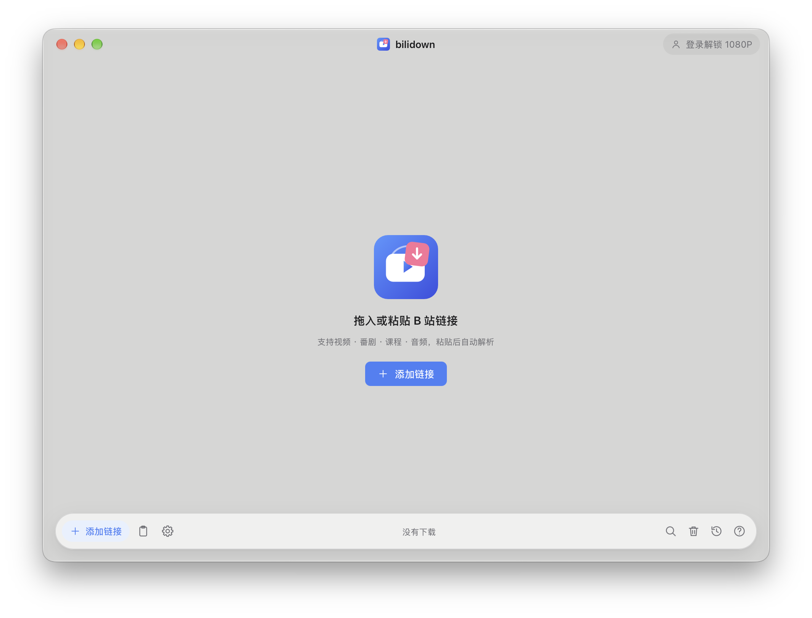

# bilidown

<p align="center">
  <strong>B 站视频下载工具。</strong><br>
  支持视频、番剧、课程和音频下载，提供 macOS 与 Windows 桌面客户端。
</p>

<p align="center">
  <a href="https://github.com/Goldloli/bilidown/releases/latest"></a>
  <a href="https://github.com/Goldloli/bilidown/actions/workflows/ci.yml"></a>
  <a href="LICENSE"></a>
</p>

<p align="center">
  
</p>

## 下载

从 [GitHub Releases](https://github.com/Goldloli/bilidown/releases/latest) 获取最新版本：

- macOS Apple Silicon：`bilidown_<版本>_aarch64.dmg`
- Windows x64：`bilidown_<版本>_x64-setup.exe`

macOS 与 Windows 安装包均已内置 ffmpeg，无需安装 Homebrew、系统 ffmpeg 或配置 PATH。

### 应用内更新

- macOS：更新包下载并通过 SHA256 校验后，打开 DMG 覆盖安装即可；不会静默替换正在运行的实例。
- Windows：校验通过后可点「安装并重启」，应用会先保存任务再退出并静默安装；若安装器无法启动，应用会保留并提示原因，可改用「打开安装程序」。
- 任何平台都可以直接从 [Releases](https://github.com/Goldloli/bilidown/releases/latest) 手动下载安装包覆盖升级；队列、历史、登录状态与设置会保留。

## 核心能力

| 模块 | 能力 |
| --- | --- |
| 内容与解析 | 视频、番剧/影视、课程、音频；支持 BV/AV、ep/ss/md、cheese、au/am 与 `b23.tv` 短链 |
| 添加方式 | 粘贴、拖入、剪贴板提示、单条添加与多链接批量添加 |
| 条目选择 | 多 P、分集、课程章节、音频歌单逐项勾选；UGC 合集可只选当前视频或整个合集 |
| 画质与格式 | 按账号权限选择最高可用或指定档位；编码优先支持自动、AVC、HEVC、AV1；音频可保留原格式或转为 MP3 |
| 附加产物 | 可选下载 SRT 字幕和 JPG 封面，可写入标题、UP 主、发布日期等元数据 |
| 下载队列 | 暂停、继续、取消、重试、移除；并发数可调；退出后保留任务并在下次启动恢复 |
| 历史记录 | 本地保存、状态筛选、关键词搜索、多产物展示与文件状态检查 |
| 账号 | B 站 App 扫码登录、自动续期；凭据仅保存在本机 |
| 桌面体验 | 明暗主题、强调色、动效偏好、原生菜单与快捷键、系统通知、应用内更新 |
| 平台集成 | macOS Dock 徽标；Windows 系统托盘、任务栏进度与资源管理器定位 |

## 支持平台

| 平台 | 架构 | 系统要求 | 安装包 |
| --- | --- | --- | --- |
| macOS | Apple Silicon | macOS 13+ | `.dmg` |
| Windows | x64 | Windows 10 22H2+ / Windows 11 | NSIS `-setup.exe` |

当前不提供 Intel Mac、Linux、ARM Windows 或移动端构建。

## 安装

### macOS

1. 打开下载的 DMG。
2. 将 `bilidown.app` 拖入「应用程序」。
3. 打开「终端」，运行以下命令：

   ```bash
   sudo xattr -cr /Applications/bilidown.app
   ```

   如果安装到了其他目录，请将命令中的路径替换为实际 `.app` 路径。
4. 从启动台或「应用程序」打开 bilidown。

macOS 版内置原生 arm64 ffmpeg（约 21 MB）。当前构建使用 ad-hoc 签名，尚未经过 Apple 公证；不执行上述命令时，macOS 可能提示「bilidown 已损坏，无法打开」。

### Windows

1. 运行 `bilidown_<版本>_x64-setup.exe`。
2. 按向导完成当前用户安装。

安装包默认安装到用户目录，不触发 UAC 提权。当前构建尚未配置代码签名，SmartScreen 可能提示未知发布者，可选择「更多信息 → 仍要运行」。

### 校验下载

每个 Release 同时提供 `SHA256SUMS.txt`。下载后可校验安装包完整性：

```bash
shasum -a 256 -c SHA256SUMS.txt
```

Windows PowerShell 可使用：

```powershell
Get-FileHash .\bilidown_<版本>_x64-setup.exe -Algorithm SHA256
```

## 快速开始

1. 点击「添加链接」，或把 B 站链接直接拖入窗口。
2. 单条内容会按设置中的默认偏好快速入队；多 P、合集或批量链接会打开确认面板。
3. 在确认面板中调整条目、清晰度、编码、音频格式和保存位置。
4. 在主窗口查看进度，完成后使用「在 Finder / 资源管理器中显示」打开产物。

登录 B 站账号后可解锁账号权限范围内的更高画质。未登录时仍可使用匿名可访问的档位。

## 输出与数据

默认下载目录为 `~/Downloads/bilidown`，可在设置中修改。

常见产物：

| 内容 | 输出 |
| --- | --- |
| 视频 / 番剧 / 课程 | `.mp4`，或 ffmpeg 缺失时降级保存未合并流文件 |
| 音频 | 原始 `.m4a` / `.flac`，或转码后的 `.mp3` |
| 字幕 | `.srt` |
| 封面 | `.jpg` |

应用数据默认位置：

- macOS：`~/Library/Application Support/bilidown`
- Windows：`%LOCALAPPDATA%\bilidown-data`

配置、登录凭据、任务数据库、历史、封面缓存、临时文件和日志都保存在本地。可通过环境变量 `BILIDOWN_DATA_DIR` 覆盖应用数据根目录。

设置页可查看目录占用、磁盘空间、缓存与日志，并可单独清理缓存和日志，不会删除已下载文件、设置或登录凭据。

## 从源码运行

### 环境要求

- Node.js 20+
- pnpm 11
- Rust stable
- macOS：Xcode Command Line Tools、`pkg-config`
- Windows：MSVC 工具链、Windows SDK、WebView2

### 本地开发

```bash
pnpm install
pnpm fetch:ffmpeg
pnpm dev
```

macOS 首次开发构建会静态编译并缓存 ffmpeg；后续运行直接复用缓存。Windows 开发前需执行一次 `pnpm fetch:ffmpeg` 下载固定版本的 LGPL sidecar。

### 检查

```bash
pnpm typecheck
pnpm test
pnpm qa:interactions
```

Rust 检查：

```bash
cargo test --workspace
cargo clippy --workspace --all-targets -- -D warnings
```

规格与版本检查：

```bash
openspec validate --all --strict
node scripts/version.mjs
```

首屏必载 JS 统计（构建后运行，递归统计静态 import，动态页面/面板不计入）：

```bash
pnpm build:web
node scripts/measure-first-load.mjs web/dist
```

### 构建安装包

```bash
pnpm build
```

也可以按平台指定产物：

```bash
pnpm tauri build --bundles dmg
pnpm tauri build --bundles nsis
```

构建产物：

- macOS：`target/release/bundle/macos/`、`target/release/bundle/dmg/`
- Windows：`target/release/bundle/nsis/`

## 项目结构

```text
crates/bilidown-core/   Rust 核心：B 站接口、解析、下载、ffmpeg、任务与存储
src-tauri/              Tauri 桌面壳：窗口、菜单、托盘、IPC、更新与平台集成
web/                    React 界面：队列、添加面板、历史、设置与视觉系统
scripts/                构建、版本、ffmpeg 获取/构建与验收脚本
openspec/               行为规格、变更提案与任务文档（功能变更入口）
docs/                   设计、QA 验收证据与第三方说明
AGENTS.md               协作规范（OpenSpec / Beads / CodeGraph / 验收门）
```

ffmpeg 处理链：

```text
scripts/ffmpeg.lock.json
        ↓
fetch-ffmpeg.mjs → 固定归档 / 静态构建 → src-tauri/binaries/
        ↓
Tauri externalBin → .app/.exe 内的 ffmpeg sidecar
        ↓
bilidown-core 合并 DASH 流、转码 MP3、清理取消任务
```

## 发布

发布前先同步版本号并准备 Release 说明（`release.yml` 会读取该文件，缺失会导致发布失败）：

```bash
node scripts/version.mjs --bump <版本>   # 同步 package.json / tauri.conf.json / Cargo.toml / 前端常量
node scripts/version.mjs                 # 校验四处版本一致
# 新增 .github/release-notes/v<版本>.md（Release 正文来源）
git add -A && git commit -m "chore(release): 发布 <版本>"
git tag v<版本> && git push origin v<版本>
```

推送 `v<版本>` tag 会触发 [Release workflow](.github/workflows/release.yml)，分别构建 macOS DMG 与 Windows NSIS 安装包，再由单一发布任务汇总：

- `bilidown_<版本>_aarch64.dmg`
- `bilidown_<版本>_x64-setup.exe`
- `SHA256SUMS.txt`

macOS 发布前会校验 ffmpeg 的 arm64 架构、最低系统版本、系统依赖、LGPL 配置、`libmp3lame` 能力与包内路径；Windows 发布流程保持原有 NSIS 资产与校验格式。

## 协作与规格

- 协作规范与质量门：[`AGENTS.md`](AGENTS.md)；功能/行为变更必须先写 OpenSpec change 并获用户确认，再进入实现。
- 行为规格（capability spec）：`openspec/specs/`（当前由维护者本地管理、未纳入 git）；涵盖下载、桌面外壳、界面、更新、登录、macOS/Windows 发布等契约。
- 验收记录与性能基线：`docs/qa/`（本地维护，含 macOS 真机验收、首屏/CPU/唤醒数据与平台验收状态）。

仅修改文档、不想触发 CI 时，可在 commit message 中加入 `[skip ci]`。

## 隐私与使用边界

- 登录凭据、Cookie、任务和历史仅保存在本机。
- 应用不会上传 B 站账号密码。
- 需要联网的只有 B 站接口、媒体 CDN、用户显式配置的代理和 GitHub 更新检查。
- 本项目不是哔哩哔哩官方客户端，与哔哩哔哩无隶属或授权关系。
- 请只下载你有权访问和保存的内容，并遵守平台服务条款与当地法律。

## 许可

项目代码使用 [MIT License](LICENSE)。

安装包内包含第三方媒体工具：

- Windows：BtbN FFmpeg LGPLv3 构建
- macOS：FFmpeg 8.1.3 + LAME 3.100 的 LGPL 静态 arm64 构建

对应许可证、精确版本、源码地址与构建参数会随安装包分发，详见 [`src-tauri/resources/NOTICE.ffmpeg.txt`](src-tauri/resources/NOTICE.ffmpeg.txt) 和 [`ACKNOWLEDGEMENTS.md`](ACKNOWLEDGEMENTS.md)。
